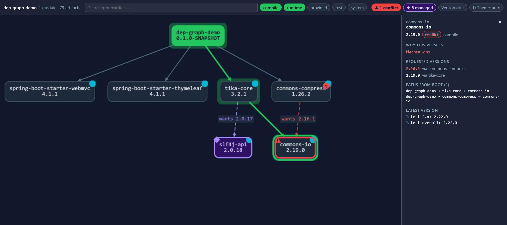

# dep-graph-maven-plugin

[](https://central.sonatype.com/artifact/dev.rabauer/dep-graph-maven-plugin)
[](https://github.com/JohannesRabauer/maven-dep-graph/actions/workflows/ci.yml)
[](LICENSE)

**See why Maven picked that version.** This Maven plugin turns your build's dependency tree into
one interactive HTML page. Click any artifact to see which version won, which versions lost, the
path that requested each one, and whether a newer release exists. The page is one file that
works offline.

**[Website](https://johannesrabauer.github.io/maven-dep-graph/)** ·
**[Live demo](https://johannesrabauer.github.io/maven-dep-graph/demo/)** ·
**[300-module stress test](https://johannesrabauer.github.io/maven-dep-graph/stress/)**

<a href="https://johannesrabauer.github.io/maven-dep-graph/demo/">
  <picture>
    <source srcset="site/assets/hero-light.png" media="(prefers-color-scheme: light)">
    
  </picture>
</a>

## Quick start

**Try it once**, without touching your POM:

```bash
mvn dev.rabauer:dep-graph-maven-plugin:0.1.0:graph
```

Then open `target/dep-graph.html`. In a multi-module build, put `package -DskipTests` before the
goal so the modules can resolve each other.

**Generate it on every build** by adding the plugin to your (root) `pom.xml`:

```xml
<plugin>
    <groupId>dev.rabauer</groupId>
    <artifactId>dep-graph-maven-plugin</artifactId>
    <version>0.1.0</version>
    <executions>
        <execution>
            <goals>
                <goal>graph</goal>
            </goals>
        </execution>
    </executions>
</plugin>
```

The `graph` goal runs in the `package` phase. Requirements: Java 21+ and Maven 3.9+.

## What the page shows

| | |
|---|---|
| 🟥 **Conflicts** | When nearest-wins drops a requested version, the winner gets a red outline and the losing edge is dashed and labelled `wants 2.16.1`. A red badge counts the conflicts; click it to step through each one. Red is used for nothing else. |
| 🟪 **Managed versions** | A version pinned by `dependencyManagement` (a BOM or parent) gets a violet outline, and the panel names the BOM. These pins are usually deliberate, so they are kept separate from conflicts and have their own toggle. |
| 🔵 **Newer releases** | A cyan dot marks artifacts that have a newer release. The panel shows the latest release in the same major version and the latest overall. |
| 🟩 **Modules** | A multi-module build gets one page for the whole reactor, starting from a module overview. A library shared by several modules appears once, with an edge from each module that uses it. |

Click a node to open its panel:

- **Why this version:** nearest wins or managed, or both.
- **Requested versions:** every requested version with the path that requested it; dropped versions are struck through.
- **Paths from root:** every path from a module down to the artifact.
- **Latest version:** the newest release in the same major and overall.

Also on the page:

- **Context menu** (right-click or Shift+F10):
  - show only what a node depends on
  - highlight all paths from root
  - hide a subtree

  An active filter always shows as a chip in the top bar.
- **Scope switches** for compile, runtime, provided, test and system.
- **Version drift view:** a neutral marker for libraries that resolve differently in different modules.
- **Search** for any `group:artifact`.
- **Keyboard navigation**, plus dark and light themes.
- **Scale:** a synthetic build with 300 modules, 4,760 artifacts and 124k edges produces a 4.3 MB page that opens in under a second.

## Options

| Property | Default | What it does |
|---|---|---|
| `depgraph.outputFile` | `${project.build.directory}/dep-graph.html` | Where the page is written |
| `depgraph.checkLatest` | `true` | Looks up the latest released versions at build time; `false` skips it |

Set them on the command line (`-Ddepgraph.checkLatest=false`) or in the plugin's `<configuration>`
(`<checkLatest>false</checkLatest>`).

The latest-version lookup asks your configured repositories, mirrors and credentials for the
available versions, so it needs network access at build time. Offline builds (`mvn -o`) skip it
automatically. The page itself never needs a network connection.

### Multi-module and partial builds

Declare the plugin once, in the root POM. The goal runs in every module, but the page is written
exactly once, covering every module of the current reactor. Normally the top-level project writes
it, to `target/dep-graph.html` next to the root POM. With `-pl` or `-rf`, the top-level project is
not part of the reactor; the last project to build writes the page instead, still to
`target/dep-graph.html` under the directory you started Maven in. An explicit
`-Ddepgraph.outputFile=...` always wins.

## Building from source

| Folder | What it is |
|---|---|
| `dep-graph-maven-plugin/` | The plugin (goal `dep-graph:graph`) |
| `demo-project/` | "Zipper", a small Spring Boot app that uses the plugin the way any other project would, from the local Maven repository |
| `site/` | The static project website; the Pages workflow adds the two live demo pages |

```bash
mvn -f dep-graph-maven-plugin/pom.xml install    # unit tests + integration tests
node --test dep-graph-maven-plugin/src/test/js/graph-model.test.js
mvn -f demo-project/pom.xml package               # writes demo-project/target/dep-graph.html
```

`mvn -f demo-project/pom.xml spring-boot:run` starts the demo app on http://localhost:8080.

### Releasing (maintainers)

Pushing a tag such as `v0.2.0` runs the [release workflow](.github/workflows/release.yml). It sets
the version from the tag, then builds, signs and publishes the plugin to Maven Central, and
creates a GitHub Release. The POM on `main` stays on a `-SNAPSHOT` version. The workflow needs three
repository secrets:

- `CENTRAL_USERNAME` and `CENTRAL_TOKEN`: a Central Portal user token
- `GPG_PRIVATE_KEY`: an ASCII-armored secret key without a passphrase, whose public key is on
  `keyserver.ubuntu.com`

## Built live on stream

This repository was created from scratch in the JUG Oberpfalz live coding session
*"From Design to Spec to Code: Building a Real UI With AI Agents"* by
[Johannes Rabauer](https://github.com/JohannesRabauer) and
[Pasha Finkelshteyn](https://github.com/asm0dey).

<a href="https://youtube.com/live/mufzjT87pmI">
  
</a>

▶ [Watch the recording on YouTube](https://youtube.com/live/mufzjT87pmI)

## License

[Apache License 2.0](LICENSE). The page bundles Cytoscape.js, dagre and cytoscape-dagre (all MIT);
see [THIRD-PARTY-NOTICES.md](dep-graph-maven-plugin/THIRD-PARTY-NOTICES.md).
